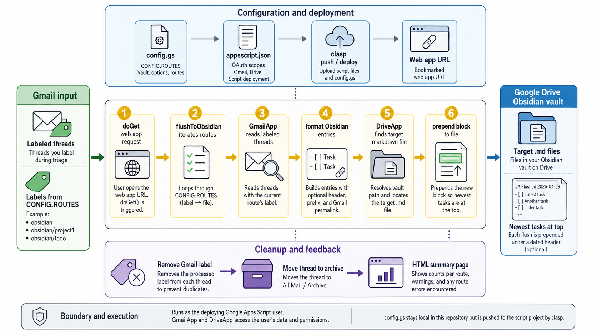

# Gmail-to-Obsidian setup and operations

## Setup

For a new installation, prepare the local files:

```bash
git clone https://github.com/tsilva/gmail2obsidian.git
cd gmail2obsidian
make setup
```

Edit `config.gs` with your vault path and routes, then validate:

```bash
make check test
```

Create a Google Apps Script project at [script.google.com](https://script.google.com). Add script files named `gmail2obsidian` and `config`, and paste the contents of `gmail2obsidian.gs` and your configured `config.gs` respectively. In **Project Settings**, enable **Show appsscript.json manifest file in editor**, then copy the local `appsscript.json` into that manifest and save. Keep credentials in Script Properties, never in source files.

Create a Web app deployment with **Execute as: Me** and **Who has access: Only myself**, authorizing the requested Gmail/Drive access as the owner when prompted. Keep project sharing **Restricted**, with only your account as an editor. Bookmark its web app URL. To use it, apply a configured Gmail label, open the bookmark, then click **Flush labeled emails**. Opening or refreshing the page never flushes mail. Confirmation expires after five minutes and can be used once; reload to obtain a new one after failure or expiry.

### Updating an existing deployment manually

1. Run `make check test` locally.
2. Open the existing Apps Script project as its owner. Copy the updated `gmail2obsidian.gs` into the `gmail2obsidian` script file and save. Preserve the existing `config` and Script Properties unless intentionally changing configuration. Review any manifest changes separately, retaining the intended owner-only or opted-in webhook access policy.
3. Choose **Deploy → Manage deployments**, select the intended existing web app, then **Edit → New version → Deploy**. Preserve its URL and **Execute as: Me** setting. Keep its selected access policy; an existing webhook deployment may use **Anyone** as described below.
4. Open the existing bookmark to check the confirmation page without starting an import. A real flush modifies Gmail and Drive.

Clasp is retired for this workflow. Do not reinstall or authenticate it to update the script. Updating local files or saving editor changes alone does not update a versioned deployment.

## Optional proxy-token import

The optional proxy-token mode authenticates a fixed import trigger without giving
the client Gmail, Drive or Apps Script API access. Its separate random webhook
capability stays in the configured proxy and Apps Script; the client receives a
public placeholder. Normal browser setup and local tests need no secret manager.

The proxy substitutes a token; it does not compute HMAC. The new server mode
therefore requires exactly `action`, `timestamp`, `requestId`, and `token` in a
JSON POST. It checks `WEBHOOK_PROXY_TOKEN` in Script Properties, fixed actions,
timestamp limits and import replay IDs. `check` returns authentication status
without Gmail/Drive access or import-state changes. `flush` uses the existing
locked routing and count-only response. Legacy HMAC mode below remains separate;
its key never enables proxy-token authentication. Because the proxy mode carries
the token in the HTTPS body, do not record request bodies on either side.

### Manual main-account handoff

Main-account clasp access has been revoked. Do not log it back in. After local
preparation, the owner must do these steps in their own browser:

1. In the existing Apps Script project, replace the `gmail2obsidian` code with
   the current local `gmail2obsidian.gs` and save. Do not replace `config` or
   create another project. The deployed version already has the required
   manifest scopes and public execute-as-owner web-app settings.
2. Through trusted administration, configure the same random
   **WEBHOOK_PROXY_TOKEN** in the chosen proxy service and Apps Script
   **Project Settings → Script Properties**. Keep its value out of chat, source,
   files, command arguments and logs. Remove `WEBHOOK_SECRET` only when explicitly
   retiring HMAC access.
3. Choose **Deploy → Manage deployments → Edit → New version → Deploy** for
   the existing web app. Keep **Execute as: Me** and **Who has access: Anyone**.
   Preserve its deployment ID/URL and keep project sharing **Restricted**.

This key transfer is trusted provisioning, not an ordinary client operation.
For rotation, update both Apps Script and the proxy through trusted
administration before checking authentication. Ordinary clients never retrieve
the source value.

### Webhook client

The standard-library client accepts `check` or `flush` and a private JSON config
containing `version`, `webhook_url` and `receipt_directory`. Its environment must
already contain the reviewed proxy settings, process-local CA trust and public
`WEBHOOK_PROXY_TOKEN=gmail2obsidian_proxy_placeholder`.

Require `ok: true` and `status: authenticated` from `check` before an authorized
import. `flush` sends one request, follows Google's response redirect once without
forwarding the request body, and writes private receipts. Require `status: complete`
and establish local Drive sync before filing. Pending, partial or unknown receipts
need inspection before retrying; preserve the inbox-flush per-item approvals.

Authentication checks wait up to 30 seconds. Import requests wait up to seven
minutes for the six-minute Apps Script runtime and response redirect. A timeout
leaves the original receipt unknown; reconcile destinations before another import.
See [Apps Script quotas](https://developers.google.com/apps-script/guides/services/quotas#current_limitations).

## Optional legacy HMAC import webhook

An agent can trigger the existing configured import without receiving Google
credentials, Gmail API access, or editor access to this project. The script still
runs under the main account that owns its Gmail authorization. A Betty account is
not required for this protocol; possession of the signing secret authorizes the
fixed import operation. Imported content remains visible at its configured Drive
destinations. Keep project sharing **Restricted** and do not grant the caller
editor access.

The HMAC mode is disabled until `WEBHOOK_SECRET` is configured and the deployment
allows external requests. To enable it in the main account:

1. Upload the updated `gmail2obsidian.gs` and `appsscript.json` together. The
   additional `userinfo.email` scope protects the existing browser confirmation
   path by checking that the visitor is the deploying owner. Reauthorize as the
   owner if prompted. A missing visitor identity is rejected.
2. Generate a random 32-byte secret locally (for example, run
   `openssl rand -hex 32` in your own terminal). In Apps Script **Project Settings
   → Script Properties**, set `WEBHOOK_SECRET` to those 64 lowercase hex
   characters. Store the caller's copy in approved private credential storage;
   never put it in source, chat, URLs, command arguments, or logs. Do not set or
   manually clear `WEBHOOK_USED_REQUESTS`; the script manages replay protection.
3. For this opt-in deployment, change `webapp.access` in `appsscript.json` from
   `MYSELF` to `ANYONE_ANONYMOUS`, retaining `USER_DEPLOYING`. Update the intended
   deployment using the manual update steps above, then verify
   **Execute as: Me** and **Who has access: Anyone** in **Manage deployments**.
   This makes the URL reachable without Google login; application-level signature
   verification controls imports. The checked-in default stays owner-only.
   An organization policy may prevent anonymous deployments.
4. Give the caller the deployed `/exec` URL and provision its signing secret
   privately. The caller needs no main-account Google authorization. Use signed
   POSTs for automated imports; the browser confirmation remains owner-only.

### Request protocol

POST `application/json` with exactly these fields:

```json
{
  "action": "flush",
  "timestamp": 1793368800,
  "requestId": "0123456789abcdef0123456789abcdef",
  "signature": "<64 lowercase hexadecimal characters>"
}
```

Generate a fresh cryptographically random 16-byte request ID, encoded as 32
lowercase hex characters. `timestamp` is integer Unix seconds, accepted from
120 seconds ago to 30 seconds in the future. Compute HMAC-SHA256 over this exact
UTF-8 text (LF separators, no final newline), and encode the digest as lowercase
hex. The HMAC key is the **literal 64-character secret string**, not hex-decoded
bytes:

```text
gmail2obsidian:v1
flush
<timestamp>
<requestId>
```

The body cannot select accounts, Gmail queries, routes, destination paths, limits,
or executable code. Accepted request IDs are persisted before processing under
the same lock as browser imports. A replay is rejected even if processing failed;
rotating or removing `WEBHOOK_SECRET` revokes the previous signing key.

Apps Script Content Service redirects responses; callers must follow Google's
response redirect and read the final JSON. HTTP success alone is insufficient.
Only `ok: true` with `status: "complete"` reports a finished batch. The response
contains `imported`, `errors` and `warnings` counts, without subjects, bodies,
paths, or provider error details. The count is new entries written by completed
routes, not proof of local Obsidian synchronization or an empty Gmail label.

`unauthorized` makes no import attempt. `busy` has not consumed the request and
can be retried unchanged within its validity window. `already_used` prevents
another attempt; it does not prove the earlier import succeeded.
`partial_failure`, `more_may_remain` and `failed_or_unknown` require inspection
before another attempt with a new ID. A dropped response is also an unknown
outcome: do not automatically issue a fresh signed request. Existing interruption
and Drive concurrency limitations below still apply. The replay ledger admits
at most 100 unexpired request IDs; additional requests return `busy`.

Before starting an inbox flush, the caller must verify this import result and
that the changed Drive files have synced locally, then stop the importer while
the inbox is being filed. Merely enabling this endpoint does not change the
separate `private-skills_inbox-flush` skill or install a scheduled trigger.

## Configuration

`make setup` copies `config.example.gs` to `config.gs` if it does not exist. `config.gs` is ignored by git; copy its contents into the Apps Script `config` file during initial setup. Preserve the live configuration during routine code updates.

```javascript
const CONFIG = {
  VAULT_FOLDER: "Obsidian/YourVault",
  MAX_THREADS: 50,
  ENTRY_PREFIX: "checkbox",
  ENTRY_LINK: false,
  ENTRY_HEADER: true,
  ROUTES: [
    { label: "obsidian", file: "@inbox.md" },
    { label: "obsidian/project1", file: "project1/inbox.md" },
  ],
};
```

Use `VAULT_FOLDER_ID` instead of `VAULT_FOLDER` when the vault is in a shared or cross-account Drive folder. If you set `ENTRY_LINK: true`, set `GMAIL_ACCOUNT_INDEX` when Gmail permalinks should open a non-default Google account, such as `/u/1`.

## Output

By default, each email becomes a checkbox under a dated flush header:

```markdown
#process

## Flushed 2026-04-29
- [ ] Meeting notes from Tuesday (body: Please review the agenda before Thursday.)
- [ ] Project proposal review
```

The file-level `#process` tag is added once when needed. When the first message has body text, it is collapsed to one line and appended as `(body: ...)` after the subject, unless the normalized body is identical to the subject. Imported subjects and bodies are encoded as literal Markdown text: sender links, images, note embeds and HTML do not become active markup. Punctuation may be escaped in the raw `.md` file and displays normally when rendered. `ENTRY_PREFIX` can be `"checkbox"`, `"bullet"`, or `"none"`. `ENTRY_LINK: true` adds an app-generated Gmail link around the literal subject, and `ENTRY_HEADER` controls the dated header.

Dynamic child labels use the same formatting. When a child label falls back to the configured inbox file, the label leaf is inserted as an Obsidian tag:

```markdown
## Flushed 2026-04-29
- [ ] #parsefood Recipe follow-up
```

## Commands

```bash
make setup   # install git hooks and create config.gs if missing
make check   # validate Apps Script syntax, example config, and manifest JSON
make test    # run tests with mocked Google services
```

Local validation requires Node.js 24 or newer, Python 3 and Make, with no npm packages or Google credentials. GitHub Actions runs `make check` and `make test` on pushes and pull requests. CI uses native Git checkout and preinstalled Node.js 24 from the Ubuntu 24.04 runner tool cache, supporting the repository's local-actions-only policy without external actions or runtime downloads. Checkout verifies the tested commit and does not persist its read-only job token. Tests cover task output, failed writes, child-label routing, legacy markers, locking, inert GET, confirmation expiry/replay, hostile email markup, signed POST verification, durable replay rejection, owner checks and private RPC helpers. A live flush modifies real mail and Drive files; verify the confirmation page without pressing its button when only checking deployment.

## Notes

- Target `.md` files must already exist in the Drive vault.
- Files that receive new entries are automatically tagged with `#process` if they do not already contain that tag.
- Gmail labels must match `CONFIG.ROUTES` exactly; nested labels use `/`.
- Child Gmail labels below a configured route are discovered automatically. For `obsidian/parsefood`, the script looks next to the configured inbox file for `parsefood.md`, then `git-parsefood.md`, then falls back to the inbox file with `#parsefood`.
- More specific Gmail labels take precedence over parent labels. If a thread has both `obsidian` and `obsidian/git-aipit`, it is flushed only through `obsidian/git-aipit`; after a successful child flush, matching parent labels are removed too.
- Flush executions are serialized to prevent overlapping requests from writing the same labeled threads twice. Legacy Gmail thread markers from older versions are still recognized, but new entries do not include hidden comments.
- An interruption after a Drive write and before Gmail cleanup can duplicate entries on retry. The script lock also cannot coordinate independent Drive editors; avoid editing destination files during a flush.
- `MAX_THREADS` caps each label batch to avoid Apps Script timeouts. Run the web app again if the summary reports that the cap was reached.
- Routes fail independently. Missing labels are skipped; target file errors are reported in the HTML summary without stopping other routes.
- Manual updates must select the existing deployment to preserve its URL; recheck its intended access policy after updating (owner-only by default, or the webhook opt-in above).
- `appsscript.json` requests Gmail modify, Drive and user email identity scopes. These are broad account permissions: configured labels and a vault folder restrict this code's behavior, not the OAuth grant. No trigger-management scope is requested. Removing a requested scope does not prove previously granted access was removed from Google's connection record.
- Confirmations are owner-bound, short-lived and single-use, consumed under the same script lock as processing. All internal helpers end in `_`, preventing direct calls through `google.script.run`. Only `doGet`, `confirmFlush` and `doPost` are public handlers, with owner checks or signed-request verification.
- Only `gmail2obsidian.gs`, the intended `config.gs`, and reviewed `appsscript.json` changes belong in Apps Script; local tools and tests are not deployed.

## Architecture



The diagram illustrates routing. The web entry point now requires explicit confirmation before starting this flow.

## Brand Assets

Generated logo, icon, favicon, social, and store-size assets live in [`image-assets`](../image-assets). The README logo is synced to [`logo.png`](../logo.png).
